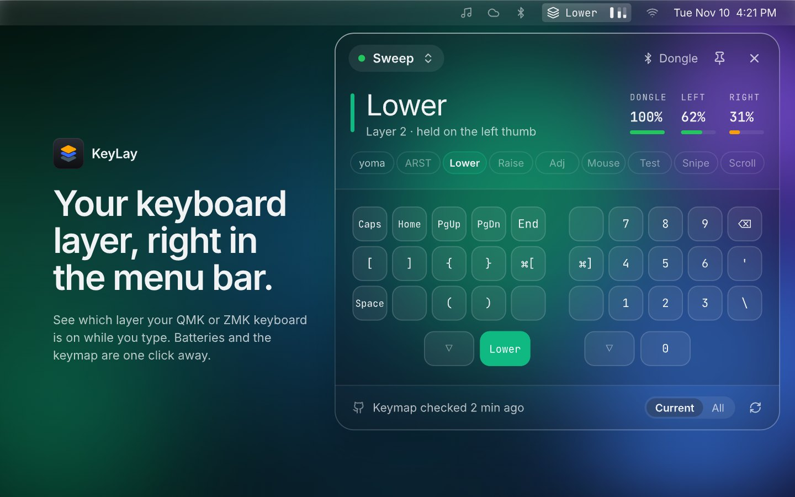
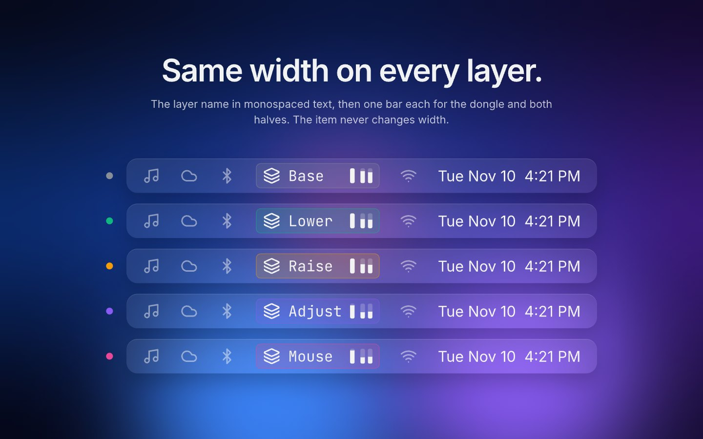
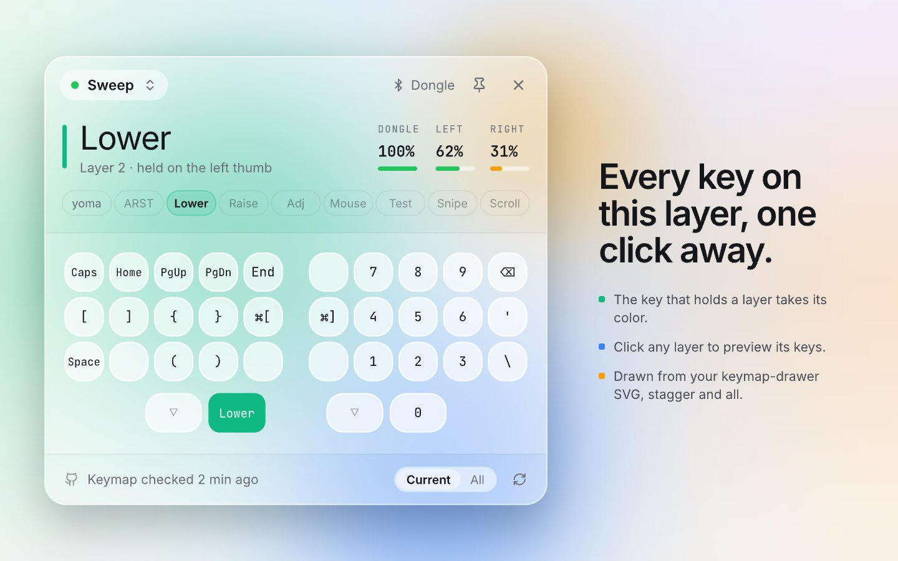
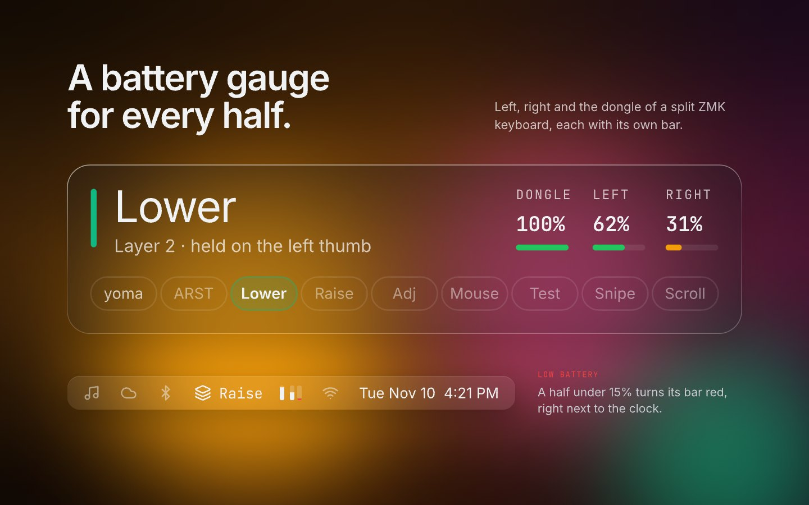
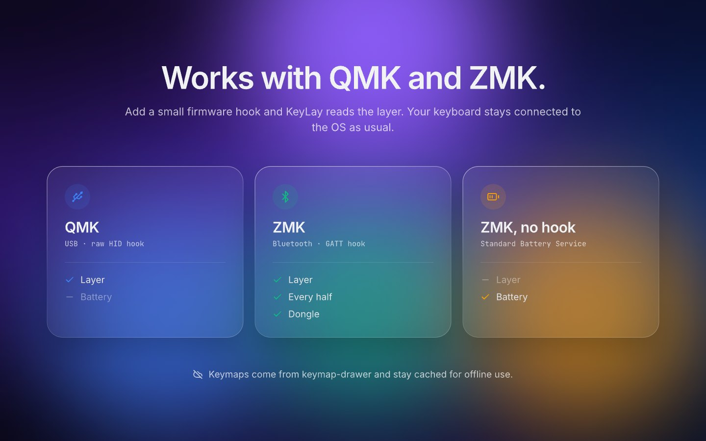

# KeyLay

Your keyboard layer, right in the menu bar. KeyLay is a macOS menu bar and Windows tray
app for QMK and ZMK keyboards: it shows the active layer, the battery of every half, and a
cheat sheet of every layer.



<p>
  
  
  
  
</p>

- **Menu bar**: the layer name, always 6 characters wide, and the lowest battery. On
  Windows, a badge in the layer's color.
- **Cheat sheet**: your keymap-drawer SVG, column stagger and all. Click a layer to preview it.
- **QMK and ZMK**: a small firmware hook reports the layer, over USB raw HID (QMK) or
  Bluetooth (ZMK).
- **Always current**: keymaps are checked against GitHub every 15 minutes.
- **Settings window**: add keyboards (connected ones are found for you), paste a keymap URL,
  rename layers, order batteries; no JSON editing.
- **KeyLay key**: a key in your keymap (`KL_OPEN` in QMK, `&keylay` in ZMK) opens and closes
  the cheat sheet for that keyboard.

## Build

```bash
npm install
npm run build
```

## More

- Firmware hooks and the protocol: [firmware/](firmware/)
- Config, details and troubleshooting: [docs/guide.md](docs/guide.md)
- Design: [design/keylay.pen](design/keylay.pen) ([pen.dev](https://pen.dev))
